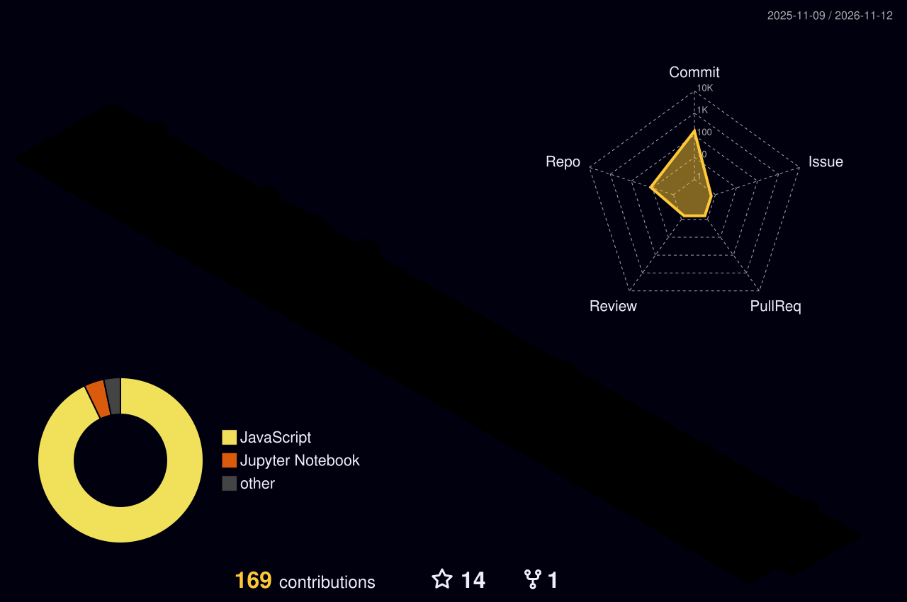
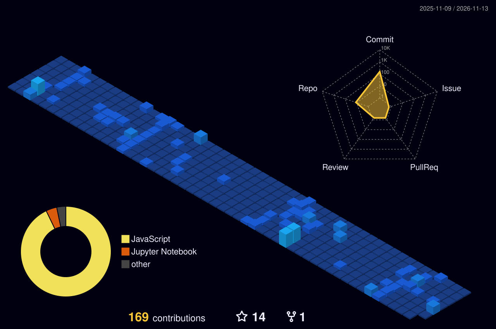

 

  

---

## 🌌 ABOUT ME

### 👋 Hi, I'm Vipin Jaiswal

I'm a passionate developer from India 🇮🇳 who loves building intelligent systems and modern digital experiences.

- 💼 Currently working at **Trendtide Connect Private Limited**
- 🧠 Exploring Artificial Intelligence and Machine Learning
- 🚀 Building modern full-stack applications
- 🔬 Interested in Deep Learning and Computer Vision
- 🌐 Exploring Creative Coding and 3D Web Development
- 🤝 Open to collaborations in AI/ML and Full-Stack Development
- 📫 Email: **vipin78040@gmail.com**

### 💻 My Developer Philosophy

> Engineering systems that learn, adapt, and scale.

---

## ⚡ MY TECH UNIVERSE

### 💻 Programming Languages

### 🎨 Frontend & Creative Development

### ⚙️ Backend & Database

### 🤖 AI & Machine Learning

### 🛠️ Tools & Platforms

---

## 🚀 FEATURED PROJECTS

<table>
<tr>
<td width="50%" align="center" valign="top">

### 🩺 Multiple Disease Prediction

**Python · Machine Learning**

</td>
<td width="50%" align="center" valign="top">

### 🐦 Bird Species Classification

**Python · TensorFlow · Keras**

</td>
</tr>
<tr>
<td width="50%" align="center" valign="top">

### 🧾 AI Invoice Generator

**MERN · Gemini AI**

</td>
<td width="50%" align="center" valign="top">

### 🎬 Movie Discovery App

**React · JavaScript · Tailwind CSS**

</td>
</tr>
</table>

---

## 🧊 3D CONTRIBUTION UNIVERSE

---

## 📊 GITHUB ANALYTICS

---

## 🔥 GITHUB STREAK

---

## 🌐 CONTRIBUTION ACTIVITY

---

## 🐍 CONTRIBUTION SNAKE

---

## 🏆 GITHUB TROPHIES

---

## 🤝 CONNECT WITH ME

  

### 💜 Thanks for visiting my GitHub Universe!

'''

out = Path("/mnt/data/README.md")
out.write_text(readme, encoding="utf-8")
print(f"Created full README.md: {out} ({len(readme)} characters)")
